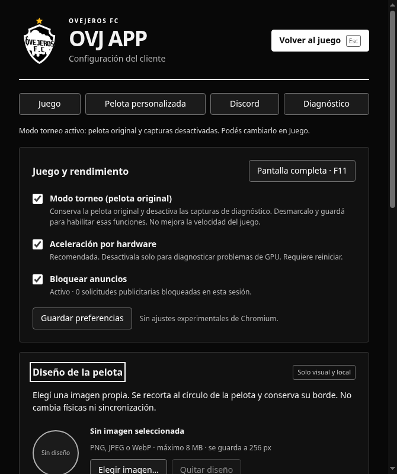

# OVJ App · Ovejeros FC

## Descargar e instalar

[Descargar ZIP del instalador para Windows](https://github.com/thiagoolavayen/OVJ-App/releases/download/v0.1.3/OVJ-App-0.1.3-Instalador-Windows.zip) · [Ver la versión y otras descargas](https://github.com/thiagoolavayen/OVJ-App/releases/tag/v0.1.3)

Extraé el ZIP y abrí el archivo Setup-Preview.exe. No necesitás Node.js. Para abrir sin instalar, elegí el portable en la página de la versión.

Compilaciones preliminares sin firma. Las pruebas automatizadas en Windows no sustituyen una partida real ni mediciones de latencia.



Captura de la configuración real de 0.1.3 ejecutada desde un ASAR en Linux. La prueba usa un juego offline para comprobar los controles.

Primera versión de un cliente de escritorio para HaxBall, preparado para Windows 10/11 x64. Carga el juego desde su sitio oficial, conserva aceleración por hardware y utiliza Electron **45.3.3** con Chromium versionado. La elección busca compatibilidad y pruebas reproducibles; no se ha demostrado menor input lag, ping ni mejor rendimiento que Chrome o Edge.

Incluye menús visibles para acceder a las funciones, preferencias persistentes, pantalla completa, bloqueo de anuncios, recuperación explícita ante errores, Discord Rich Presence por IPC local y diseños personales de pelota. No implementa macros, automatización de movimientos, cambios de físicas ni manipulación de paquetes.

## Ejecutable Windows preliminar

La descarga ofrece **OVJ-App-0.1.3-x64-Portable-Preview.exe** para Windows 10/11 de 64 bits. No requiere Node.js ni compilar el código en tu PC: abrí ese archivo directamente. El portable extrae temporalmente el runtime y lo elimina al cerrar. Las preferencias se conservan en `%APPDATA%\OVJ App`. También se incluye `OVJ-App-0.1.3-x64-Setup-Preview.exe`, que instala para el usuario actual y crea accesos directos de escritorio y menú Inicio.

Esta compilación está sin firma y pendiente de verificación en una PC Windows real. Incluye el escudo original de Ovejeros FC, su estrella dorada y los iconos de Windows derivados de ese mismo archivo. Discord puede configurarse después y no impide abrir el juego. La comprobación de PE, recursos, integridad ASAR y extracción completa del portable está documentada en [pruebas](docs/testing.md).

## Ejecutar desde el código

Necesitás Node.js 24 LTS y conexión a Internet:

```powershell
npm ci
npm test
npm run check
npm start
```

El juego abre directamente con una barra de menús visible: **OVJ App**, **Pelota**, **Discord**, **Diagnóstico** y **Publicidad**. Cada menú lleva a sus controles; los ajustes también tienen navegación por secciones. **F10** sigue abriendo ajustes; **F11** o **Alt + Enter** cambia pantalla completa; **Esc** cierra ajustes; **Ctrl + Shift + R** solicita confirmación antes de recargar. En pantalla completa podés usar esos atajos. No se pide administrador para jugar. Pantalla completa es la de Chromium/Windows; no se promete presentación exclusiva ni bypass de DWM.

La aceleración por hardware queda activada por defecto. Desactivarla es un recurso de diagnóstico y requiere reiniciar. No se fuerzan tasas de FPS, VSync, prioridades del sistema ni flags experimentales. El **Modo torneo (pelota original)**, activado por defecto, mantiene desactivados el adaptador de pelota y la captura periódica de métricas; no promete acelerar el juego. El tema negro y blanco de los menús se aplica una vez al cargar cada documento.

## Publicidad

El bloqueo viene activado. Cancela solicitudes a CPMStar, usado por la página pública de HaxBall, y a dominios publicitarios concretos de Google. También oculta el panel lateral de anuncios en `/play`. Se controla desde **Publicidad → Bloquear anuncios** o desde **Juego** en los ajustes; la elección se guarda.

La lista es local y acotada: no descarga listas ni envía telemetría. No incluye los servicios de autenticación, CAPTCHA, fuentes o transportes de HaxBall. No garantiza eliminar anuncios servidos desde dominios nuevos; el bloqueo puede actualizarse si cambia el proveedor.

## Identidad de OVJ

La interfaz, los menús HTML y el instalador usan negro, blanco y grises. El escudo conserva su diseño original y la estrella dorada cuando se incorpora el archivo. Los colores que comunican equipos y estados del juego siguen siendo los de HaxBall. El tema no aplica filtros a la cancha ni cambia tamaños, físicas o controles. Más detalles en [tema visual](docs/game-theme.md).

## Poner tu diseño en la pelota

1. Abrí **Pelota → Personalizar pelota…** y elegí **Elegir imagen…**. Admite PNG, JPEG y WebP de hasta 8 MiB y 4096 × 4096 px.
2. La primera activación ofrece **Guardar para después** o **Aplicar y recargar**. Si estaba activo el modo torneo, el diálogo avisa que se desactivará para usar tu diseño.
3. **Aplicar y recargar** abandona la sala actual. Si guardaste para después, usá el aviso **Recargar HaxBall…** cuando puedas salir de la sala. Una nueva imagen puede aplicarse sin recarga si el adaptador ya está cargado.

La imagen se optimiza a un máximo de 256 px, se recorta al círculo y conserva el borde de la pelota. Se ve solo en tu cliente. No cambia su tamaño físico, colisiones ni comportamiento. El adaptador identifica el objeto de pelota real del renderer de una versión verificada por SHA-256; si HaxBall cambia, conserva el dibujo original. No usa una heurística por color/radio ni modifica a los jugadores. Las ligas pueden tener reglas propias sobre cambios visuales.

Al volver al modo torneo se oculta inmediatamente la imagen; si el adaptador ya estaba cargado, recargá para retirar también su código. En el inicio de ese modo no se transforma el JavaScript del juego. El tema y el bloqueo de publicidad permanecen disponibles sin bucles propios durante el partido. Más detalles en [diseños de pelota](docs/ball-skins.md).

## Discord

La integración está implementada y admite reconexión automática, duración desde el inicio y limpieza al cerrar. Necesita Discord de escritorio abierto y el **Application ID** público de una aplicación llamada **OVJ App**. La descarga no trae un ID configurado, por lo que la actividad no aparece hasta completarlo en **Discord → Configurar actividad…**. No necesita token, contraseña ni bot. El Application ID puede dejarse vacío para jugar; se configura una sola vez. Para el escudo, subí el PNG al portal de Discord con la clave `ovj_logo`.

Utiliza el transporte RPC de escritorio documentado por Discord, sin autenticación OAuth; no se presenta como el Social SDK nuevo. El estado publicado describe la app abierta y no inventa sala, marcador ni partida. La verificación contra Discord real está pendiente. Instrucciones y fuentes en [Discord](docs/discord.md).

## Logo y ejecutables Windows

El escudo oficial de **Ovejeros FC** recibido en el ZIP ya está en assets/logo.png y los iconos en assets/icon.ico. El PNG original se conserva íntegro. Para repetir la conversión:

```powershell
npm run branding -- "C:\ruta\al\escudo-original.png"
npm run dist:win
```

La conversión conserva el PNG original y genera los tamaños ICO de Windows. El build exige esos archivos. Produce instalador NSIS por usuario y ejecutable portable x64, ambos sin firma configurada. Los workflows de GitHub Actions compilan y verifican en Windows; el de publicación toma los artefactos de esa compilación y publica el ZIP del instalador, el portable y sus checksums en la versión preparada de GitHub. Ver [compilación y distribución](docs/build.md).

Para reproducir el portable preliminar, ejecutá `npm run dist:win:preview`; para generar también el instalador, usá `npm run dist:win:preview -- --installer`. Si existen los archivos del escudo, los incorpora. Si faltan, retira los iconos de Electron sin inventar otro emblema. Mantiene la integridad del paquete y genera un informe de hashes en `dist-preview`.

## Datos y privacidad

En Windows las preferencias y el perfil del juego se guardan en `%APPDATA%\OVJ App`. Los archivos propios son `settings.json` y, si importaste un diseño, `ball.png`. El perfil Chromium conserva el almacenamiento que HaxBall necesite. OVJ no añade almacenamiento de contraseñas ni telemetría. No hay un servidor de OVJ ni descargas automáticas de actualizaciones.

Una configuración corrupta se aparta como `settings.json.invalid-…` y se recuperan valores seguros. La desinstalación conserva los datos; para restablecer por completo, cerrá la app y eliminá esa carpeta. No borres el perfil durante una partida.

El diagnóstico opcional toma intervalos `requestAnimationFrame` durante 60 segundos y exporta JSON y CSV. Registra callbacks, no FPS presentados ni input-to-photon. La exportación contiene versiones, estado de GPU y una instantánea de procesos de OVJ; excluye chat, nombre/enlace de sala, Application ID e imagen. No toma muestras durante el juego normal.

## Verificación y límites

Consultá [estado de pruebas](docs/testing.md) para distinguir lo ejecutado de lo pendiente. La comparación competitiva exige Windows, un monitor real y medición controlada; no se incluyen resultados inventados. [La guía de benchmarks](docs/benchmarks.md) describe comparaciones con Chrome/Edge, PresentMon, consumo y medición tecla a fotón.

- [Arquitectura y comparación de tecnologías](docs/architecture.md)
- [Seguridad y límites de aislamiento](docs/security.md)
- [Pruebas y benchmarks](docs/benchmarks.md)

El juego HaxBall no se redistribuye con este proyecto. Su servicio y sus actualizaciones pertenecen a sus responsables. OVJ App es un cliente independiente en fase de validación.
